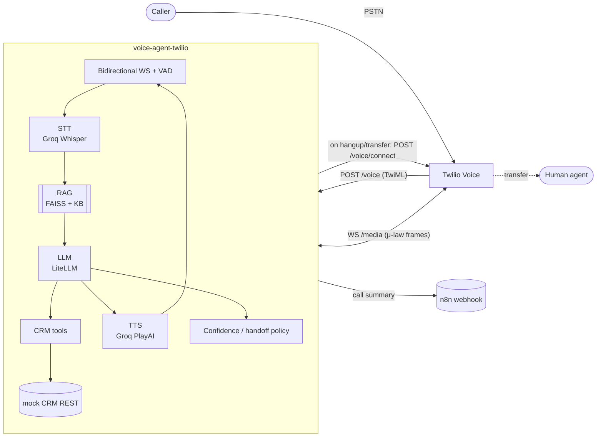
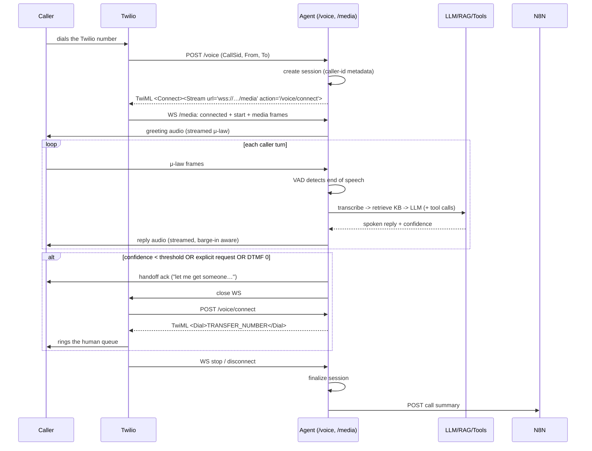

# voice-agent-twilio

A production-shaped **voice AI support agent** that answers real phone calls through
Twilio Media Streams. Each turn runs **speech-to-text → retrieval-augmented LLM →
text-to-speech** in a streaming loop, can call **CRM tools** for order/account
lookups, and **hands the caller off to a human** (Twilio `<Dial>`) when it is not
confident or the caller asks for one.

It runs fully offline for development and the test suite (mock LLM/STT/TTS + a
local mock CRM), and in production against Groq (STT/TTS + Llama) or any
LiteLLM-supported model (OpenAI, Gemini, …).

---

## Features

- **Twilio Media Streams pipeline** — bidirectional WebSocket, 20 ms μ-law frames,
  energy-based VAD/endpointing, barge-in via `clear`.
- **Streaming STT → LLM → TTS** per turn with sentence-level TTS chunking.
- **Hybrid RAG** over the Markdown KB (`knowledge/`): IDF-weighted lexical coverage
  blended with embedding cosine (FAISS `IndexFlatIP`, numpy fallback). Runs with a
  dependency-free *hashing* embedder or `fastembed` (bge-small) when available.
- **CRM tool calls** (`lookup_order`, `list_orders`, `get_customer`, `create_ticket`)
  with automatic caller-id / call-SID / session-id propagation as request headers.
- **Confidence scoring & human handoff** — explicit-request detection, low STT
  confidence, refusals, ungrounded answers, failed tools, and a DTMF `0` escape
  hatch all route to a `<Dial>` transfer.
- **n8n call-summary webhook** — structured payload (topics, transcript,
  tool calls, latencies) posted on call end.
- **Per-turn latency metrics** — `GET /metrics/turns` (avg/p50/p95, per-stage).
- **Scripted eval** — 25 scenarios measuring containment, tool success and answer
  keywords, runnable offline or against a live server.
- **Tests + Docker** for everything above.

---

## Architecture



### Call flow



---

## Quick start (local)

Requirements: Python 3.11+ and, for real calls, a Twilio number + an `ngrok`/cloudflare tunnel.

```powershell
python -m venv .venv; .venv\Scripts\Activate.ps1
pip install -r requirements-dev.txt

Copy-Item .env.example .env   # then fill in keys (already provided in .env)

# terminal 1 — mock CRM
uvicorn mock_crm.server:app --port 8001

# terminal 2 — agent
uvicorn app.main:app --port 8000 --reload

# terminal 3 — public tunnel, then set PUBLIC_BASE_URL to the https URL
ngrok http 8000
```

Sanity check without a phone:

```powershell
curl http://localhost:8000/healthz
curl -X POST http://localhost:8000/agent/sessions -H "content-type: application/json" -d '{\"caller_id\":\"+15550001111\"}'
curl -X POST http://localhost:8000/agent/turn -H "content-type: application/json" -d '{\"text\":\"Where is order ORD-1001?\",\"caller_id\":\"+15550001111\"}'
```

### Docker

```powershell
docker compose up --build      # agent on :8000, mock-crm on :8001
```

The tunnel still points at the **agent** container (`ngrok http 8000`).

---

## Twilio setup

1. **Buy/select a number** → *Voice Configuration* → *A call comes in* →
   **Webhook** `https://<your-tunnel>/voice`, method `POST`.
2. Set `PUBLIC_BASE_URL=https://<your-tunnel>` in `.env` (used to build the
   `wss://…/media` stream URL and the `/voice/connect` action URL).
3. Inbound calls are greeted, then handed to the Media Stream. When the WebSocket
   closes, Twilio calls `/voice/connect`, which returns `<Dial>` **only** if the
   session requested a transfer.
4. **Trial accounts**: the call is preceded by a trial message, and
   `TRANSFER_NUMBER` must be a **verified** number or `<Dial>` fails. You can only
   call in from verified numbers too.

> No API keys for Twilio itself are required by the runtime — the signature of the
> webhook is not enforced in this reference implementation. Put it behind a tunnel
> you control and add `X-Twilio-Signature` validation before exposing it publicly.

---

## Configuration

All settings live in `app/config.py` (`Settings`) and are read from env / `.env`.

| Variable | Default | Purpose |
| --- | --- | --- |
| `PUBLIC_BASE_URL` | (empty) | Public https base used to build the `wss://…/media` URL. |
| `LLM_PROVIDER` / `LLM_MODEL` | `litellm` / `groq/llama-3.3-70b-versatile` | LiteLLM routing (`mock` for offline). |
| `STT_PROVIDER` / `STT_MODEL` | `groq` / `whisper-large-v3-turbo` | Transcription. |
| `TTS_PROVIDER` / `TTS_MODEL` / `TTS_VOICE` | `groq` / `playai-tts` / `Fritz-PlayAI` | Speech. |
| `EMBEDDINGS_PROVIDER` | `auto` | `auto` \| `fastembed` \| `hashing` \| `none`. |
| `CONFIDENCE_THRESHOLD` | `0.6` | Below this → human handoff. |
| `TRANSFER_NUMBER` | (empty) | Human queue for `<Dial>`. |
| `HANDOFF_DIGIT` | `0` | DTMF digit that forces a transfer. |
| `CRM_BASE_URL` / `CRM_API_KEY` | `http://localhost:8001` / `dev-crm-key` | Tool backend. |
| `N8N_WEBHOOK_URL` | (empty) | Call-summary endpoint. Empty disables summaries. |

VAD/endpointing knobs (`VAD_SILENCE_MS`, `VAD_START_RMS`, `VAD_MIN_SPEECH_MS`,
`MAX_UTTERANCE_S`, …) are also in `app/config.py`.

---

## HTTP / WS API

| Method | Path | Description |
| --- | --- | --- |
| `POST` | `/voice` | Twilio inbound webhook → TwiML `<Connect><Stream>`. |
| `POST` | `/voice/connect` | `<Connect>` action → optional `<Dial>` transfer. |
| `WS` | `/media` | Twilio bidirectional audio stream. |
| `POST` | `/agent/sessions` | Create a text-mode session (dev/testing). |
| `POST` | `/agent/turn` | Run one text turn → reply, confidence, tools, metrics. |
| `POST` | `/calls/{call_sid}/end` | Finalize a call and post its summary. |
| `GET` | `/metrics/turns` | Per-turn latency summary + recent turns. |
| `GET` | `/rag/stats`, `POST /rag/reindex` | Retrieval index info / rebuild. |
| `GET` | `/healthz` | Liveness + provider info. |

`POST /agent/turn` example response:

```json
{
  "session_id": "CA…", "call_sid": "CA…", "turn": 1,
  "reply": "Your order ORD-1001 is shipped with an estimate of 2026-10-17.",
  "confidence": 0.92, "handoff": false, "handoff_reason": "",
  "contained": true,
  "tools": [{"name": "lookup_order", "ok": true, "latency_ms": 3.1}],
  "rag_hits": [{"doc_id": "shipping.md#0", "score": 0.71}],
  "latency": {"stt_ms": 0, "retrieve_ms": 1.2, "llm_ms": 0.4, "tool_ms": 3.1, "tts_ms": 0, "total_ms": 6.0}
}
```

---

## Knowledge base & retrieval

- Drop Markdown files into `knowledge/`. `# ` is the doc title, `## ` starts a
  section; sections are windowed into overlapping chunks.
- Retrieval blends embedding cosine with an IDF-weighted lexical-coverage score, so
  both semantic and exact-term questions rank well. Out-of-domain questions (e.g.
  weather) yield **no grounded hits** and are handed off rather than hallucinated.
- `EMBEDDINGS_PROVIDER=fastembed` downloads `BAAI/bge-small-en-v1.5` (better) on
  first start; `hashing` needs no download (default here, used by the tests).

## Confidence & handoff

`app/confidence.py` scores every reply (0–1). A turn is transferred when the score
is below `CONFIDENCE_THRESHOLD` or a handoff is explicitly requested. Signals:
passing tool call `0.92`, smalltalk `0.85`, retrieval-grounded ramps
`0.35 → 1.0`, ungrounded / failed-tool `0.30`, refusals capped `0.35`, low STT
capped `0.40`, and any explicit "speak to a human"/bot-accusation → `0.0`.

## CRM tools

`mock_crm/server.py` is a FastAPI service with in-memory customers, orders and
tickets. Every request carries `X-API-Key`, `X-Caller-ID`, `X-Call-SID`,
`X-Session-ID` (inspect them at `GET /v1/_debug/requests`). Point `CRM_BASE_URL`
at a real CRM and implement the same four endpoints to go live.

## n8n call summary

Set `N8N_WEBHOOK_URL` to an n8n webhook. On call end the agent POSTs:

```json
{ "event": "call_summary", "caller_id": "+1555…", "turn_count": 3,
  "contained": false, "handoff": true, "transfer_reason": "low_confidence",
  "topics": ["shipping"], "avg_latency_ms": 41.2,
  "transcript": [{"role": "user", "content": "…", "confidence": 0.92}],
  "tool_calls": [{"name": "lookup_order", "ok": true}] }
```

---

## Example outputs

All output below is real, captured offline with the mock providers
(`EMBEDDINGS_PROVIDER=hashing`, `LLM/STT/TTS=mock`, in-process mock CRM).

### `GET /healthz`

```json
{
  "status": "ok",
  "app": "voice-agent-twilio",
  "environment": "eval-offline",
  "providers": {
    "llm": "mock/mock",
    "stt": "mock",
    "tts": "mock",
    "embeddings": "hashing",
    "vector_backend": "faiss"
  },
  "rag_ready": true,
  "sessions": 0,
  "transfer_configured": false,
  "n8n_configured": false
}
```

### `POST /agent/sessions`

```json
{
  "session_id": "CAtest0487e46e954b47d88eb0",
  "call_sid": "CAtest0487e46e954b47d88eb0",
  "caller_id": "+15550001111",
  "greeting": "Thanks for calling Acme support. How can I help you today?"
}
```

### `POST /agent/turn` — order lookup (tool call)

Request:

```json
{ "text": "Where is order ORD-1001? I want to track it.",
  "session_id": "CAtest0487e46e954b47d88eb0",
  "caller_id": "+15550001111", "synthesize": false }
```

Response (trimmed):

```json
{
  "session_id": "CAtest0487e46e954b47d88eb0",
  "turn": 1,
  "reply": "Your order ORD-1001 is shipped. with an estimate of 2026-10-17. totaling $49.99.",
  "confidence": 0.92,
  "handoff": false,
  "handoff_reason": "",
  "contained": true,
  "tools": [
    { "name": "lookup_order", "arguments": { "order_id": "ORD-1001" },
      "ok": true, "latency_ms": 7.3, "error": null }
  ],
  "rag_hits": [
    { "doc_id": "shipping.md#1", "title": "Q: How do I track my order?", "score": 0.7134 },
    { "doc_id": "orders_and_billing.md#0", "title": "Q: How can I check my order status?", "score": 0.5588 }
  ],
  "latency": { "retrieve_ms": 1.96, "llm_ms": 8.06, "tool_ms": 7.30, "tts_ms": 0.0, "total_ms": 10.67 },
  "audio_b64": null
}
```

### `POST /agent/turn` — human handoff

Request: `{ "text": "Please connect me to a human agent.", ... }`

```json
{
  "turn": 2,
  "reply": "Of course. Let me get someone on the line for you.",
  "confidence": 0.0,
  "handoff": true,
  "handoff_reason": "explicit request: \\b(speak|talk|chat|connect|put|transfer)\\b[^.?!]{0,30}\\b(hum",
  "contained": false,
  "tools": [],
  "rag_hits": [],
  "latency": { "total_ms": 0.44 }
}
```

When the call then ends, `/voice/connect` returns the transfer TwiML (shown for a
session with `TRANSFER_NUMBER=+15559876543` and `TWILIO_PHONE_NUMBER=+15551230000`):

```xml
<?xml version="1.0" encoding="UTF-8"?><Response><Dial timeout="30" callerId="+15551230000"><Number>+15559876543</Number></Dial></Response>
```

### `GET /metrics/turns` (summary)

```json
{
  "summary": {
    "turns": 2,
    "avg_total_ms": 5.6,
    "p50_total_ms": 5.6,
    "p95_total_ms": 10.2,
    "avg_retrieve_ms": 1.0,
    "avg_llm_ms": 4.0,
    "avg_tool_ms": 3.6,
    "avg_tts_ms": 0.0,
    "handoffs": 1,
    "avg_confidence": 0.46
  }
}
```

---

## Evaluation

25 scripted calls across FAQ / tools / account / warranty / store / handoff /
multi-turn categories. Each turn declares expected containment, tool use and
answer keywords.

```powershell
python -m scripts.eval --offline --no-tts              # in-process, no keys needed
python -m scripts.eval --base-url http://localhost:8000 --verbose
python -m scripts.eval --offline --json eval-report.json
python -m scripts.eval --offline --scenario order      # single scenario
```

`python -m scripts.eval --offline --no-tts`:

```
====================================================================
 EVAL REPORT — 25 calls, 30 turns
====================================================================
  containment rate        :  76.0%
  expectation match rate  : 100.0%
  avg latency / turn      :    1.6 ms
  p95 latency / turn      :    5.0 ms
  avg client-side turn    :    3.7 ms
  stage avg               : stt 0.0ms | retrieve 0.6ms | llm 0.6ms | tool 0.5ms | tts 0.0ms
  tool-call success       : 3/4 (75.0%)
  answer keyword accuracy : 23/23 (100.0%)
  wall time               : 0.2s
--------------------------------------------------------------------
  category         calls  contain   match   lat ms
  account              3   100.0%  100.0%      0.9
  faq                  7   100.0%  100.0%      1.0
  handoff              4     0.0%  100.0%      0.7
  multi-turn           3    66.7%  100.0%      1.7
  store                3   100.0%  100.0%      1.5
  tools                3    66.7%  100.0%      5.4
  warranty             2   100.0%  100.0%      1.0
====================================================================
```

The 24 % non-containment is **exactly the 6 scenarios designed to hand off**
(4 explicit handoff + `unknown-order` + the last turn of `hours-then-human`).
The single failed tool call is the intentional `ORD-9999` lookup that routes the
caller to a human — so tool success `3/4` and `expectation match 100 %` are both
the expected result. Latency stays in the low milliseconds because every provider
is mocked; swap in Groq/LiteLLM to measure real end-to-end latency.

## Tests

```powershell
python -m pytest          # 93 tests
python -m ruff check .
```

```
$ python -m ruff check .
All checks passed!

$ python -m pytest
........................................................................ [ 77%]
.....................                                                    [100%]
93 passed in 27.81s
```

Coverage: μ-law codec & resampling, TwiML builders, RAG retrieval & tokenization,
confidence/handoff policy, CRM tools + metadata propagation, `/voice` +
`/voice/connect`, text turns through the agent, the `/media` WebSocket pipeline
(VAD → STT → reply) and DTMF handoff, metrics endpoints, and the offline eval.

---

## Project layout

```
app/
  main.py        FastAPI app + routes (/voice, /media, /agent/*, /metrics/*)
  streams.py     Media Streams pipeline: VAD/endpointer, playback, barge-in, handoff
  agent.py       Turn pipeline (think / speak / commit) & metrics
  rag.py         FAISS + hybrid lexical/cosine retrieval
  confidence.py  Confidence scoring & handoff detection
  llm.py         LiteLLM client + deterministic MockLLM
  stt.py tts.py  Groq/OpenAI STT & TTS (+ mocks, tone fallback)
  tools.py       CRM tool executor + JSON tool specs
  crm_client.py  REST client with call-metadata headers
  notifier.py    n8n call-summary payload
  audio.py       Pure-numpy G.711 μ-law codec + resampler
  twiml.py       Minimal TwiML builders
  sessions.py    Call registry / history / records
  latency.py     Per-turn metrics store
  config.py      Pydantic settings
knowledge/       Markdown knowledge base
mock_crm/        Mock CRM FastAPI service
scripts/eval.py  Scripted eval harness
tests/           Pytest suite
```
